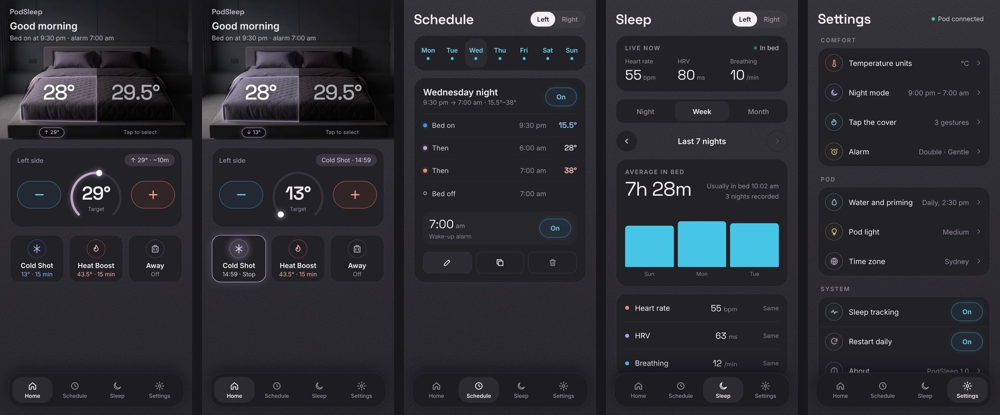

# PodSleep

A new set of screens for [Free Sleep](https://github.com/throwaway31265/free-sleep), the open-source software that runs an Eight Sleep Pod on your own network.



> **Not affiliated with or endorsed by Eight Sleep.** Like Free Sleep itself, using it may void your Pod's warranty. Use at your own risk; see [LICENSE.md](LICENSE.md).

## What it adds

- **The bed, lit by temperature.** Each side of a photo-real bed glows in its temperature's colour: deep blue at 13°, through cyan and a neutral lavender, to coral-red at 43.5°. Tap a side to select it, turn it on or turn it off.
- **A draggable dial** and − / + buttons for the selected side.
- **Cold Shot and Heat Boost.** The coolest or warmest setting for 15 minutes, then back to where you were. The timer runs on the Pod, so it carries on if your phone sleeps or the Pod restarts.
- **Away mode** on Home.
- **Schedule** built around a night: bed-on time, wake-up, a temperature range and suggested changes through the night, plus your own changes. Copy a night to any other nights in one go.
- **Sleep** (if Free Sleep's sleep tracking is on): live heart rate, HRV and breathing, each night's chart, and weekly or monthly averages.
- **Settings** for units, night mode, alarm feel, water and priming, Pod light, time zone and more. Tap controls are hidden on covers that don't have them (Pod 3).
- Works offline on your home network; add it to your phone's home screen and it opens full-screen.

## Before you install

- Free Sleep is installed and working (tested with **3.0.3**) (`http://<pod-ip>:3000` opens).
- SSH to the Pod works on port 8822. If it doesn't, run Free Sleep's `scripts/setup_ssh.sh` on the Pod first (see Free Sleep's install guide). Test with `ssh -p 8822 root@<pod-ip> echo ok`.
- Tested on a **Pod 3**. Pod 4 and Pod 5 should work but haven't been tested yet; reports welcome.
- The Windows installer hasn't been tested on a real PC yet; reports welcome.

## Install

1. Download the latest `podsleep-<version>.zip` from [Releases](../../releases/latest) and unzip it.
2. **Mac or Linux:** open Terminal in the unzipped folder and run
   ```
   bash install-from-computer.sh
   ```
   **Windows 10 or 11:** open PowerShell in the unzipped folder and run
   ```
   powershell -ExecutionPolicy Bypass -File .\install-from-windows.ps1
   ```
3. Enter your Pod's IP address when asked. It takes under a minute and ends with *"PodSleep installed. Cold Shot / Heat Boost: working."*
4. Open `http://<pod-ip>:3000` on your phone. To keep it on your home screen: iPhone, Share › Add to Home Screen; Android (Chrome), menu › Add to Home screen.

**After every Free Sleep update, run the install again.** Free Sleep updates replace PodSleep's files.

### What the installer changes on the Pod

- Backs up Free Sleep's own screens to `/home/dac/podsleep-backup`.
- Replaces `server/public` (the screens) with PodSleep's.
- Adds one small server route, `/api/boost`, for the Cold Shot / Heat Boost timer, and two marked lines in `server/dist/setup/routes.js` to load it.
- Restarts Free Sleep and checks it comes back. If it doesn't, it puts Free Sleep back by itself.

Your schedules, settings and sleep data aren't touched.

## Remove

Mac or Linux: `bash install-from-computer.sh uninstall`
Windows: `powershell -ExecutionPolicy Bypass -File .\install-from-windows.ps1 uninstall`

This puts Free Sleep's own screens back and removes the boost route.

## Known issues

- **Sleep tab shows readings but no time in bed.** On some Pods, Free Sleep's sleep analyser never detects a sleep period (its log says *"No sleep periods found"*), even though heart-rate readings are recorded. PodSleep then shows each night's readings from 7 pm to noon without claiming a time in bed. The cause is in Free Sleep's analyser, not PodSleep.
- Cold Shot and Heat Boost need the boost route. If a future Free Sleep version changes its routes file, the installer installs the screens and skips the boost route, and the app says so when you tap Cold Shot.

## Building from source

This repository is a fork of Free Sleep. PodSleep's screens live in `app/src/ps`; the boost route is `server/src/routes/boost/boost.ts`; install scripts are in `podsleep/`.

```
cd app && npm ci && cd ../server && npm ci && cd ..
bash podsleep/build-release.sh        # makes podsleep/release/podsleep-<version>.zip
cd app && VITE_ENV=demo npm run dev     # try it in a browser with demo data
```

## Support

Best effort. Open an issue with your Pod model, Free Sleep version and what the installer printed. No guarantee of a fix or a reply.

## Credits and licence

Built on [Free Sleep](https://github.com/throwaway31265/free-sleep) by throwaway31265 and contributors, under the MIT licence; PodSleep's changes are released under the same licence. See [LICENSE.md](LICENSE.md) and [NOTICE.md](NOTICE.md). Free Sleep's original README is kept at [docs/FREE_SLEEP_README.md](docs/FREE_SLEEP_README.md).

Eight Sleep and Pod are trademarks of Eight Sleep, Inc., used here only to say what this works with.
